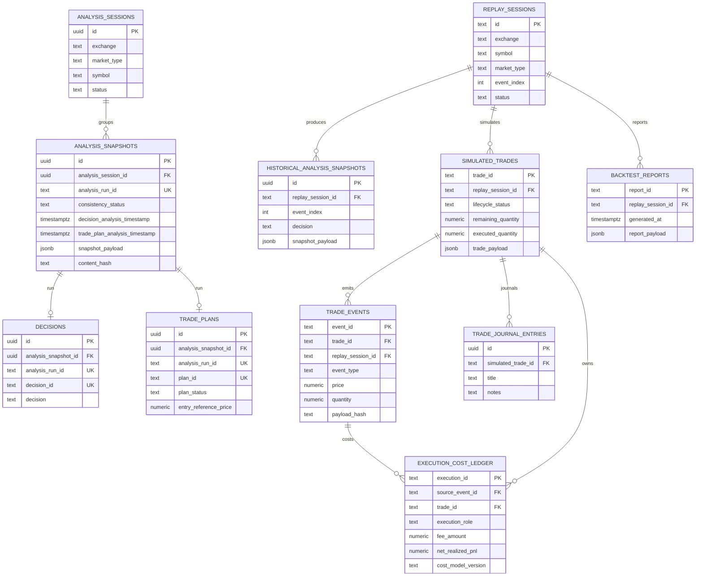

# Phase 6.0.1 — Entity Relationships

**Refinement 6.0.1.1:** `analysis_run_id` correlation; composite FKs for events/ledger; RESTRICT-only financial deletes.

## 1. Conceptual model

- **Live path:** `analysis_sessions` 1—* `analysis_snapshots` ; each snapshot shares `analysis_run_id` with 0..1 `decisions` and 0..1 `trade_plans`
- **Replay path:** `replay_sessions` 1—* `historical_analysis_snapshots`, `simulated_trades`, `backtest_reports`
- **Simulation path:** `simulated_trades` 1—* `trade_events` 1—* `execution_cost_ledger` ; `simulated_trades` 1—* `trade_journal_entries`

No `users` entity.

## 2. Integrity edges (critical)

```
simulated_trades (trade_id, replay_session_id)
    ↑ FK
trade_events (trade_id, replay_session_id)
    ↑ FK (trade_id, source_event_id) → (trade_id, event_id)
execution_cost_ledger
```

- Event session must equal trade session.
- Ledger event must belong to same trade (composite FK).
- Journal cannot delete or mutate financial parents (RESTRICT + app rules).

## 3. Mermaid ER diagram



## 4. Cardinality notes

| Relationship | Cardinality | Notes |
|--------------|-------------|-------|
| Snapshot ↔ Decision extract | 1:0..1 | Same `analysis_run_id` |
| Snapshot ↔ Trade plan extract | 1:0..1 | Same `analysis_run_id` |
| Trade → Events | 1:N | Append-only; idempotent `event_id` |
| Event → Ledger | 1:N | At most one row per `(event, execution_role)` |
| Trade → Journal | 1:N | Metadata only |

## 5. Diagram location

Canonical ER for Phase 6.0.1 / 6.0.1.1: this file.
